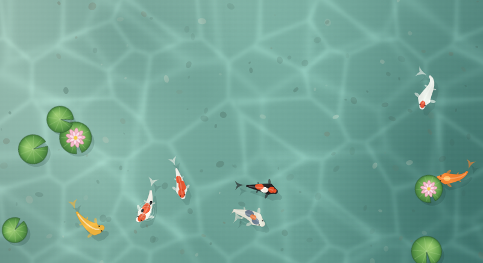

# 🎨 Agent-Skins

> **Live Animated Skins & Liquid Glass Themes for AI Coding & Chat Agents**  
> Đưa không gian làm việc sống động, nghệ thuật và sang trọng vào **Google Antigravity App**, **Claude Desktop** và các phần mềm AI Agent.

---

## 🌟 Danh mục Themes (Themes Gallery)

| Theme | Mô tả | Hỗ trợ | Xem trước |
| :--- | :--- | :---: | :---: |
| **🎏 Koi Pond** | Hồ cá Koi bơi lội dưới làn nước ban mai trong vắt, đàn cá Showa, Sanke, Kohaku, Ogon sinh động. | `Antigravity` `Claude` | [Xem ảnh](themes/koi/preview.png) |
| **🍁 Autumn Koi** | Hồ Koi mùa thu thanh tịnh với lá phong Nhật và lá bạch quả rơi rụng theo từng nhịp sóng. | `Claude` | [Xem ảnh](themes/autumn/preview.png) |
| **🖌️ Sumi Ink** | Tranh thủy mặc phong cảnh sơn thủy hữu tình, thuyền nan trôi và đàn chim tung cánh. | `Claude` | [Xem ảnh](themes/sumi/preview.png) |
| **🏺 Earth Glass** | Tông màu đất nung ấm áp kết hợp các mảng kính mờ Liquid Glass sang trọng. | `Claude` | [Xem ảnh](themes/earth/preview.png) |
| **🛰️ Cyber HUD** | Giao diện Sci-Fi tương lai với tâm ngắm reticle, radar quét và luồng dữ liệu lục giác. | `Claude` | [Xem ảnh](themes/cyber/preview.png) |
| **🔶 Motion** | Đồ họa phẳng Flat Motion hiện đại, chuyển động nhịp nhàng theo trạng thái suy nghĩ của AI. | `Claude` | [Xem ảnh](themes/motion/preview.png) |
| **💅 Slay** | Typography nghệ thuật động kinetic pop-up cá tính, đậm phong cách thời thượng. | `Claude` | [Xem ảnh](themes/slay/preview.png) |
| **✳️ Attention** | Mặt giấy ấm áp mộc mạc, các sợi liên kết từ ngữ trôi dạt đa ngôn ngữ. | `Claude` | [Xem ảnh](themes/attention/preview.png) |

---

## 🚀 Cách Cài Đặt (Installation)

### Cách 1: Để AI Agent tự cài đặt (Khuyên dùng ⭐⭐⭐⭐⭐)
Bạn chỉ cần đưa thư mục repository này cho AI Agent của bạn (Antigravity Agent, Claude Code, Cursor,...) và nói:

> *"Đọc file AGENT.md trong thư mục này rồi cài theme cho mình."*

AI Agent sẽ:
1. Đọc [AGENT.md](AGENT.md).
2. Tự động liệt kê danh sách theme kèm link ảnh minh họa để bạn chọn (nếu bạn chưa nói rõ).
3. Hỏi bạn muốn cài cho app nào (`Antigravity App` hay `Claude Desktop`).
4. Tự động chạy lệnh cài đặt mà bạn không cần phải gõ dòng lệnh nào!

---

### Cách 2: Cài đặt thủ công bằng tay (Manual)

#### Dành cho Google Antigravity App:
1. Đảm bảo ứng dụng Antigravity App đang mở trên máy tính.
2. Mở thư mục theme bạn muốn cài: `themes/koi/antigravity/`.
3. Nhấp đúp vào **`install.bat`** (hoặc mở terminal gõ `node inject.mjs`).
4. Theme sẽ lập tức hiển thị sống động trên cửa sổ Antigravity!
5. **Tự khởi động cùng Windows**: Nhấp đúp vào `autostart-on.bat`.
6. **Gỡ bỏ**: Nhấp đúp vào `uninstall.bat`.

#### Dành cho Claude Desktop App:
1. Yêu cầu Node.js 22 trở lên. Claude đang ở giao diện **Sáng (Light Mode)**.
2. Trong Claude: Menu (☰) → **Developer** → Tích chọn **Enable Main Process Debugger**.
3. Mở thư mục theme tương ứng (ví dụ: `themes/koi/claude/`) và nhấp đúp vào **`install.bat`** (hoặc gõ `node inject.mjs`).
4. Tắt bỏ tích **Enable Main Process Debugger** để bảo mật an toàn.
5. **Gỡ bỏ**: Nhấp đúp vào `uninstall.bat` hoặc khởi động lại Claude.

---

## ⌨️ Phím tắt & Điều khiển (Shortcuts)

| Phím tắt | Ứng dụng | Chức năng |
| :--- | :---: | :--- |
| **`Ctrl + Alt + Up / Down`** | Antigravity / Claude | Tăng / giảm độ mờ kính Liquid Glass (từ 0% trong vắt đến 90%). |
| **`Ctrl + Alt + Left / Right`** | Antigravity | Tăng / giảm độ sáng lòng hồ nước (0.4x đến 1.8x). |
| **`Ctrl + Alt + G`** | Antigravity / Claude | Bật / Tắt hiệu ứng theme ngay lập tức. |
| **Tương tác chuột** | Koi / Autumn / Sumi | Rê chuột để tương tác; Click chuột để tạo sóng nước hoặc hiệu ứng. |

---

## 🔒 An toàn & Bảo mật (Security & Safety)

- **100% Mã nguồn nội bộ (Pure local code)**: Không gọi mạng ra ngoài, không gửi dữ liệu đi đâu, không can thiệp vào nội dung tin nhắn trò chuyện.
- **Không sửa đổi file gốc của phần mềm**: Toàn bộ hiệu ứng được nạp trực tiếp qua cổng lập trình chính thức (DevTools / Debugger) vào bộ nhớ RAM, khởi động lại app là trở về nguyên bản 100%.

---

## 📄 Bản quyền (License)
Dự án được phát hành theo giấy phép mã nguồn mở [MIT License](LICENSE).
