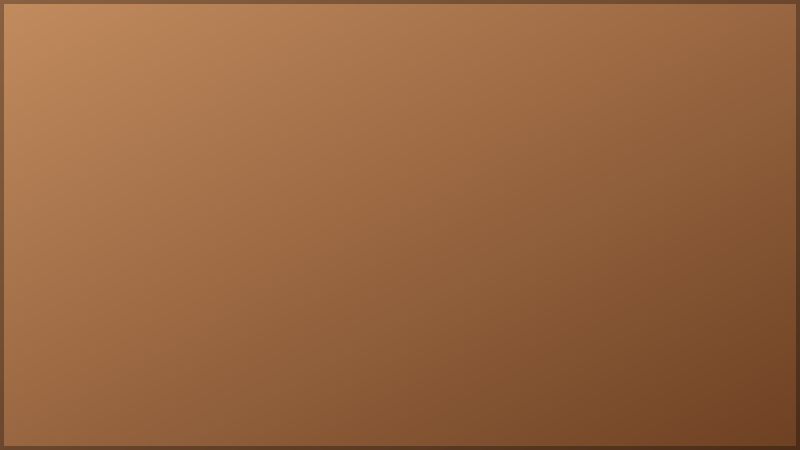

# 🏺 Earth Glass (Kính Mờ Đất Ấm)

## Giới thiệu
Phong cách tối giản với tông màu đất nung, đất sét ấm áp kết hợp các mảng kính mờ Liquid Glass sang trọng và êm dịu cho mắt.

## Hỗ trợ ứng dụng
`Claude Desktop`

## Tính năng & Hiệu ứng tương tác
- Lớp kính mờ cao cấp với viền phản quang tinh tế.\n- Ctrl+Alt+G: Bật/Tắt theme.\n- Ctrl+Alt+Up/Down: Tăng/giảm độ mờ của kính.

## Cách cài đặt

### Dành cho Google Antigravity App (nếu hỗ trợ)
1. Mở thư mục `antigravity/`
2. Nhấp đúp vào `install.bat` (hoặc chạy `node inject.mjs`)
3. Để gỡ bỏ: chạy `uninstall.bat` (hoặc `node off.mjs`)
4. Để tự động nạp mỗi lần mở app: chạy `autostart-on.bat`

### Dành cho Claude Desktop App
1. Trong Claude: Mở menu (☰) → **Developer** → Tích chọn **Enable Main Process Debugger**
2. Mở thư mục `claude/` và nhấp đúp vào `install.bat` (hoặc chạy `node inject.mjs`)
3. Tắt tích **Enable Main Process Debugger** để bảo mật
4. Để gỡ bỏ: chạy `uninstall.bat` (hoặc khởi động lại Claude)
5. Để tự động nạp mỗi lần mở app: chạy `autostart-on.bat`
