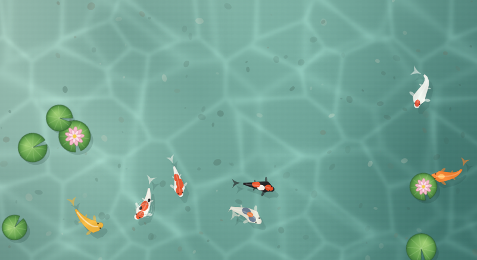

# 🎏 Koi Pond (Hồ Cá Koi)

## Giới thiệu
Hồ cá chép Koi Nhật Bản bơi lội dưới làn nước ban mai trong vắt, phản chiếu tia nắng và gợn sóng sinh động. Tích hợp chuẩn 1:1 các giống cá Showa Sanshoku, Sanke, Kohaku, Ogon, Tancho, Asagi và Kumonryu.

## Hỗ trợ ứng dụng
`Google Antigravity App` `Claude Desktop`

## Tính năng & Hiệu ứng tương tác
- Di chuột: Đàn cá bơi lại gần như đang đón ăn.\n- Click chuột: Tạo sóng nước, cá gần giật mình tản ra, cá xa bơi tới.\n- Ctrl+Alt+Up/Down: Tăng/giảm độ mờ sương của kính (0% - 90%).\n- Ctrl+Alt+Left/Right: Tăng/giảm độ sáng hồ nước (0.4x - 1.8x).\n- Ctrl+Alt+G: Bật/Tắt theme.

## Cách cài đặt

### Dành cho Google Antigravity App (nếu hỗ trợ)
1. Mở thư mục `antigravity/`
2. Nhấp đúp vào `install.bat` (hoặc chạy `node inject.mjs`)
3. Để gỡ bỏ: chạy `uninstall.bat` (hoặc `node off.mjs`)
4. Để tự động nạp mỗi lần mở app: chạy `autostart-on.bat`

### Dành cho Claude Desktop App
1. Trong Claude: Mở menu (☰) → **Developer** → Tích chọn **Enable Main Process Debugger**
2. Mở thư mục `claude/` và nhấp đúp vào `install.bat` (hoặc chạy `node inject.mjs`)
3. Tắt tích **Enable Main Process Debugger** để bảo mật
4. Để gỡ bỏ: chạy `uninstall.bat` (hoặc khởi động lại Claude)
5. Để tự động nạp mỗi lần mở app: chạy `autostart-on.bat`
